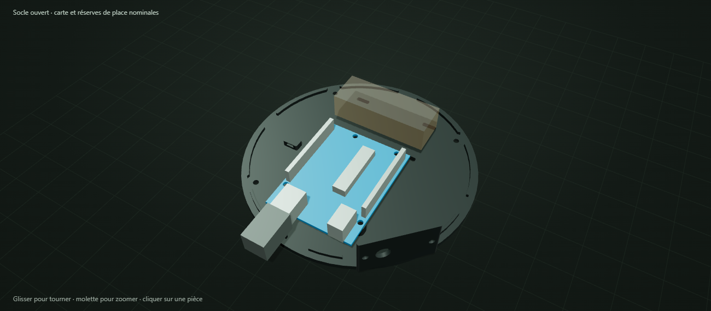

# ORBITE001 V0.3 MICRO TEST — guide du prototype

Cette version est conçue pour essayer la programmation et les mouvements d’un bras à **six MG90S**. Elle conserve cinq articulations et une pince motorisée, avec une armature courte de **60 et 50 mm entre axes**. Les premiers essais se font **sans objet dans la pince**, avec l’armature seule, sans coques décoratives.

**Statut : prototype CAO, encore non imprimé et non assemblé physiquement.** Les dimensions des moteurs achetés, les palonniers, les jeux, les vis, le câblage, les mouvements et les efforts réels restent à vérifier. La présence de six MG90S ne garantit pas que toutes les poses pourront être maintenues. Des ajustements, un allègement supplémentaire ou un rééquilibrage peuvent être nécessaires.

La version V0.2 à trois MG996R et trois MG90S est conservée dans son ancienne archive. Les pièces de cette version et celles de **MICRO TEST** ont des dimensions différentes : utiliser un seul pack pour un assemblage.

## Commencer par les gabarits

1. Ouvrir `apercu_3d.html` pour repérer les sous-ensembles. Les commandes changent seulement l’aperçu ; elles ne pilotent aucun moteur et ne définissent pas des limites mécaniques validées.
2. Importer **`gabarits_depart_A1_mini.3mf`** dans Bambu Studio. Il contient deux pièces : `G_MG90S_jeu_0p35` et `G_palonnier_base_MG90S`. Il s’agit de géométrie, pas d’un fichier déjà tranché ou d’un profil d’impression certifié.
3. Choisir l’A1 mini, la buse réelle et le filament, puis conserver **100 % de l’échelle**. Pour une buse de 0,4 mm, des couches de 0,20 mm et quatre parois constituent un point de départ à contrôler dans l’aperçu de tranchage.
4. Essayer le corps d’un MG90S dans son gabarit. Il doit entrer sans forcer, avec ses oreilles en appui et ses trous en face des lumières. Vérifier aussi l’accès aux vis. L’ouverture est fondée sur un corps nominal de **22,8 × 12,2 mm** ; mesurer les exemplaires reçus, car les variantes peuvent différer.
5. Présenter le palonnier d’origine sur le gabarit de base. Vérifier le centrage, la correspondance des trous et la place des têtes de vis. Le gabarit ne remplace pas le palonnier : les pièces imprimées se fixeront sur celui-ci.

Si le corps serre, essayer `G_MG90S_jeu_0p5`. S’il flotte trop, essayer `G_MG90S_jeu_0p2`. Le jeu est indiqué **par côté** : 0,35 mm ajoute donc 0,70 mm aux dimensions du corps. Corriger un logement localement plutôt que changer l’échelle du bras entier.

Le gabarit **`G_paliers_608_623`** permet ensuite de vérifier les logements nominaux des deux types de roulements. Un roulement doit prendre appui sans déformer ni fendre la pièce. Les résultats des gabarits serviront à ajuster les logements avant l’impression complète.

**À ce stade, imprimer seulement les gabarits et les essayer avec le matériel acheté.**

## Contenu du pack

| Élément | Utilisation |
|---|---|
| `stl/gabarits/` | Trois jeux de logement MG90S, un gabarit 608/623 et un gabarit de palonnier de base |
| `stl/structure/` | Treize pièces S01 à S13 : armature, pince et compartiment électronique |
| `sources/orbite_micro_v0_3.scad` | Source CAO ; sélection d’une pièce par son identifiant avec la variable `piece` |
| `sources/parametres.json` | Dimensions nominales et hypothèses de conception |
| `liste_pieces.csv` | Inventaire et dimensions des pièces à imprimer |
| `assemblage_visuel.glb` | Assemblage coloré pour un logiciel de visualisation |
| `assemblage_visuel_NE_PAS_IMPRIMER.stl` | Vue d’ensemble figée, avec références des composants ; ce fichier n’est pas un plateau d’impression |
| `apercu_3d.html` | Vue interactive autonome, avec sélection des pièces et mode Socle ouvert |
| `socle_electronique.png` | Image de l’implantation nominale dans le compartiment |
| `verification_export.json` | Rapport des contrôles numériques des STL exportés |
| `calcul_statique_preliminaire.json` | Estimation gravitaire et limites de son interprétation |

Le pack comporte **18 STL individuels : 5 gabarits et 13 pièces de structure**. Cette version ne fournit pas de coques décoratives. Chaque pièce peut être imprimée dans une seule couleur ; un AMS n’est pas nécessaire.

Les six servos, les roulements, la carte, la fiche USB et la réserve de place pour la distribution électrique visibles dans l’aperçu sont des **références non imprimables**. La réserve de place ne garantit pas la compatibilité d’un module précis ou d’une carte PCA9685.

## Architecture

| Sous-ensemble | Pièces | Moteur et appui |
|---|---|---|
| Socle et rotation verticale | S01, S02, S03, S04 | M1 MG90S, roulement 608ZZ et retenue centrale M4 |
| Épaule | S04 → S05 | M2 MG90S, appui opposé par 623ZZ et axe M3 |
| Coude | S05 → S06 | M3 MG90S, appui opposé par 623ZZ et axe M3 |
| Inclinaison du poignet | S06 → S07 | M4 MG90S, appui opposé par 623ZZ et axe M3 |
| Rotation du poignet | S07 → S08 | M5 MG90S et palonnier fourni |
| Pince | S08, S09, S10 | M6 MG90S, doigt entraîné sur 623ZZ et axe M3 |
| Compartiment électronique fixe | S11, S12, S13 | Arduino Uno R3 nominale, distribution et fusible à adapter |

Les pièces imprimées se fixent sur les **palonniers d’origine** des servos. Aucune cannelure de servo n’est imprimée. Les lumières offrent une possibilité de réglage, mais leur correspondance avec les accessoires du vendeur doit être vérifiée par les gabarits.

## Fixer le robot sur la table

Le boîtier S11 comporte **quatre pattes de fixation**, avec des passages pour vis M4. Son encombrement maximal avec pattes est de **166 × 166 mm**, compatible en dimensions avec le volume de l’A1 mini.

Une solution pratique consiste à fixer le socle sur une planche avec quatre vis traversantes, rondelles et écrous, puis à serrer la planche sur la table avec deux serre-joints. Choisir les longueurs de vis selon l’épaisseur réelle du support. Vérifier que les quatre appuis et la planche restent stables avant d’alimenter les moteurs.

**Fixer le socle avant tout essai motorisé**, même sans objet dans la pince : le centre de gravité se déplace avec le bras.

## Montage progressif de la mécanique

1. **Tester et repérer les six servos sur le banc**, avant de fixer leurs palonniers à l’armature. Vérifier le sens de mouvement et choisir une position de référence avec une petite plage de commande. Identifier M1 à M6 et leurs câbles. Une position géométrique de l’aperçu n’est pas automatiquement une valeur de commande adaptée au servo réel.
2. Monter le servo M1 dans **S01**, puis présenter S02 et le roulement de base. Vérifier l’accès aux vis et le passage des fils avant de poursuivre.
3. Pour **S03**, monter d’abord le palonnier d’origine sur le servo avec sa vis centrale, insérer l’écrou M4 dans le logement ouvert par dessous, puis fixer S03 au palonnier par les lumières. Le roulement et le support supérieur se montent ensuite, avant S04. Les méplats de l’arbre entraînent la tourelle ; la vis centrale retient l’ensemble.
4. Monter **S04 et M2**, puis S05. Soutenir le bras pendant les essais : commencer près de la verticale et vérifier les petits mouvements de l’épaule avant d’ajouter le reste.
5. Ajouter **M3 et S06**, puis le poignet S07–S08 et ses moteurs M4–M5. Vérifier un sous-ensemble à la fois, avec des câbles libres et sans appuyer le poids du bras sur un servo hors tension.
6. Monter **M6 et les doigts S09–S10**. Vérifier à la main le jeu des engrenages et le mouvement du doigt entraîné, moteur désaccouplé si nécessaire. Ne pas forcer un servo ou la pince contre une butée.

Pour les pivots opposés aux moteurs, les rondelles de calage doivent prendre appui sur la **bague intérieure** du roulement. Le serrage ne doit pas immobiliser la bague extérieure ou la pièce mobile. Mesurer les empilements de vis, entretoises et rondelles avant de choisir les longueurs définitives.

Les fixations doivent retenir les pièces sans écraser les oreilles des microservos. Vérifier le dépassement des vis, la place des têtes, les efforts sur les petits palonniers et le trajet de chaque câble avant de motoriser le sous-ensemble.

Les berceaux sont ouverts sur un côté pour faciliter l’insertion des moteurs avant les palonniers et avant de fermer les sous-ensembles. M1 s’insère par le dessus de S01 avant le palier. Sur les supports d’épaule, de coude et de poignet, présenter le corps par le côté ouvert, puis mettre les oreilles en appui. Le moteur de pince entre par le côté extérieur de S08, à l’opposé du petit roulement passif. Les câbles et connecteurs réels doivent rester libres pendant l’insertion. Les petites lumières d’oreilles permettent un réglage de ±0,25 mm ; elles ne remplacent pas la vérification des moteurs reçus.

Le poignet S07 comporte un renfort extérieur qui contourne l’emplacement du moteur M5. Vérifier son impression et ne pas retirer ce renfort comme s’il s’agissait d’un support de tranchage.

## Électronique dans le socle

Le compartiment ajoute **40 mm** sous la mécanique. Le bouton **Socle ouvert** masque le bras et le boîtier pour montrer le fond et les références électroniques ; il s’agit d’un filtre d’affichage, pas d’une simulation de démontage physique.

| Pièce | Implantation nominale |
|---|---|
| **S11 — boîtier fixe** | Corps Ø140 × 37 mm, quatre pattes M4 et passages arrière |
| **S12 — fond démontable** | Fond Ø140 × 3 mm, trois plots de 6 mm à lumières pour une Uno R3 de 68,6 × 53,4 mm |
| **S13 — platine arrière** | Platine 42 × 25 × 2,4 mm, passage de câble Ø8 mm décalé à gauche, partie pleine à adapter à l’interrupteur |

Le connecteur USB de l’Arduino est tourné vers l’arrière. Son ouverture mesure **30 × 21 mm** ; vérifier la carte et la fiche de câble achetées, y compris la place pour brancher et débrancher. Les clones Uno peuvent avoir des connecteurs différents.

Une zone de **60 × 22 mm devant la carte** et des fentes pour colliers permettent d’étudier l’installation de la distribution et du porte-fusible. Vérifier les dimensions de ces composants, leurs bornes et leurs fils avant de les fixer.

L’ouverture derrière S13 mesure **28 × 17 mm**. Le passage Ø8 et les vis réduisent la place disponible pour l’interrupteur : définir sa découpe après achat, en tenant compte de la profondeur du corps et des bornes. Prévoir une retenue du câble basse tension pour qu’une traction ne porte pas sur les connexions.

Ordre de fermeture du compartiment :

1. Fixer S11 sous S01 avec quatre vis M4 traversantes, leurs écrous et rondelles. Serrer tant que l’intérieur reste accessible.
2. Insérer les quatre écrous M3 du fond **par le haut des bossages**, avant fermeture.
3. Fixer la carte sur les trois plots du fond avec des vis **M2,5 en nylon**, adaptées aux lumières et à la carte réelle. Ne pas contraindre le circuit imprimé.
4. Installer la distribution et le fusible, puis retenir leurs câbles avec des colliers. Garder l’accès au fusible.
5. Faire passer les fils vers le bras par l’ouverture **14 × 9 mm** dans S01, centrée en **(−40 ; −18 mm)**. Protéger le passage et garder une réserve de longueur pour la rotation de base, en vérifiant toute la plage retenue.
6. Installer S13 avec ses deux vis M3 et écrous captifs, puis fermer S12 avec quatre vis M3. Vérifier qu’aucun fil ne reste pincé.

Pour enlever le fond, débrancher l’USB, libérer les fils qui relient le fond au bras, puis soutenir le fond et la carte pendant la descente. Les longueurs de vis et l’accès aux outils restent à vérifier sur les composants réels.

Pour les premiers essais, alimenter **l’Arduino par USB** et les servos par **une alimentation séparée adaptée**, distribuée dans le socle et protégée par un fusible à dimensionner. Relier la **masse des servos à la masse de l’Arduino** pour la référence des signaux. Les six servos ne doivent pas être alimentés par la broche 5 V de l’Arduino. L’adaptateur secteur reste **à l’extérieur** ; seule sa sortie basse tension entre dans le socle.

## Quincaillerie à prévoir après les gabarits

- **6 MG90S**, leurs palonniers, vis centrales et accessoires d’origine.
- **1 roulement 608ZZ : 8 × 22 × 7 mm**, pour la base.
- **4 roulements 623ZZ : 3 × 10 × 4 mm**, pour l’épaule, le coude, le poignet et le doigt entraîné.
- Vis, écrous et rondelles **M2** pour les microservos et les adaptations aux palonniers, selon les pièces réelles.
- Vis, écrous et rondelles **M3** pour les petits pivots et les fixations adaptées ; écrous frein aux pivots si l’empilement le permet.
- Vis, écrous et rondelles **M4** pour la retenue centrale de base, les quatre fixations S01/S11 et les pattes sur la planche.
- Pour le compartiment : quatre vis M3 et écrous captifs du fond, deux vis M3 et écrous captifs de S13, trois vis M2,5 nylon pour la carte.
- Colliers, protections de passage de fils et planche de fixation avec serre-joints.

Les longueurs ne sont pas figées : les palonniers, roulements, rondelles et le support réel déterminent les empilements. Éviter de commander des longueurs supposées avant d’avoir vérifié les interfaces.

## Impression après ajustement

Les STL individuels sont à l’échelle réelle et posés à Z = 0, avec une orientation de départ proposée. Vérifier chaque orientation, les ponts et les supports dans Bambu Studio ; tenir dans le volume de l’imprimante ne valide pas le tranchage.

Pour les essais d’armature en PLA, une buse de 0,4 mm, des couches de 0,20 mm, quatre parois et un remplissage de 30–40 % constituent un point de départ. Les petits paliers, les dents de la pince et les zones de vis demandent un contrôle attentif de l’aperçu et des bavures. Imprimer puis essayer un sous-ensemble avant le suivant.

- **S11** est retourné, face annulaire supérieure vers le plateau ; vérifier les supports des ouvertures et logements d’écrous.
- **S12** se pose sur son fond plat, plots vers le haut.
- **S13** se pose à plat ; sa découpe finale dépendra du câble, du passe-câble et de l’interrupteur choisis.

## Premiers mouvements et limites

Commencer **sans charge**, avec le bras soutenu et dans une pose proche de la verticale. Tester de petites amplitudes et un moteur à la fois, puis ajouter progressivement les mouvements combinés. La plage de l’aperçu reste une commande de visualisation ; les limites des servos et du mécanisme devront être déterminées sur le prototype.

Même à vide, l’épaule porte les maillons, les moteurs du coude et du poignet, les câbles et la pince. Le MG90S est annoncé à **1,8 kgf·cm au blocage à 4,8 V** par TowerPro. Le couple de blocage ne constitue pas un couple continu admissible. Un essai sans objet ne supprime donc pas le besoin de vérifier la masse et les efforts.

La masse réelle dépendra du tranchage et des accessoires reçus. Le fichier `calcul_statique_preliminaire.json` décrit l’hypothèse utilisée pour l’estimation gravitaire ; il ne donne pas une charge utile garantie. L’accélération, les frottements, la flexion, le fluage, l’échauffement et les efforts de pince restent à valider. Le calcul conservateur à vide donne environ **0,70 kgf·cm à l’épaule dans la pose d’essai** et **1,56 kgf·cm à l’horizontale**, avec des pièces supposées pleines en PLA. Cette dernière valeur est proche du couple de blocage annoncé : **la pose entièrement horizontale ne fait pas partie des premiers essais recommandés**, même sans objet dans la pince. Si un servo peine à tenir la pose, arrêter l’essai et étudier la géométrie, la masse ou l’équilibrage.

Les contrôles numériques du pack doivent être lus avec leurs limites : ils concernent les solides et enveloppes nominales modélisés. Ils ne représentent pas tous les palonniers, vis, fils ou connecteurs réels et ne certifient pas toutes les positions intermédiaires. Les rapports disponibles accompagnent le modèle ; ils ne remplacent pas les essais d’ajustement, de montage et de mouvement.

## Contrôles fournis avec cette révision

- **18 STL individuels**, contrôlés fermés, de volume positif et en une seule composante ; dimensions inférieures à 175 mm.
- Contrôle de la pose d’essai et de **24 poses voisines**, en modifiant un seul axe de ±5° ou ±10° : aucun chevauchement supérieur à 0,5 mm³ entre les pièces imprimées et les corps nominaux des servos. Cela ne valide ni les trajectoires intermédiaires ni les angles de commande réels.
- Le compartiment électronique conserve ses contrôles d’extraction du fond, de retrait de la platine et de dégagement USB, avec des enveloppes simplifiées.
- Les six passages de montage des servos ont été contrôlés à huit positions chacun, sans fils ni palonniers. Des sondes de matière contrôlent aussi des appuis près des vis et le renfort du poignet ; ce ne sont pas des calculs de résistance.
- La masse calculée des seules pièces imprimées mobiles est d’environ **67,9 g si elles étaient pleines en PLA**. Elle exclut moteurs, vis, roulements et fils ; la masse après tranchage sera différente.

Les rapports détaillés sont `controle_maillages.json`, `verification_export.json`, `verification_poses_micro.json`, `verification_insertion_servos.json`, `verification_socle_electronique.json` et `calcul_statique_preliminaire.json`. Aucun prototype physique n’a encore été essayé.

## Programmation

Le programme Arduino reste à développer. Les organigrammes utilisés à l’université avec **VBuilder** peuvent servir à préparer la logique des séquences, mais ce pack ne fournit pas de chaîne de programmation VBuilder vers Arduino ni de programme moteur prêt à lancer.

## Références dimensionnelles

- [MG90S — fiche du fabricant TowerPro](https://towerpro.com.tw/product/mg90s-3/)
- [Arduino Uno R3 — fiche technique officielle et dessin de la carte](https://docs.arduino.cc/resources/datasheets/A000066-datasheet.pdf)
- [A1 mini — guide Bambu Lab et volume 180 × 180 × 180 mm](https://cdn1.bambulab.com/documentation/quick-start-f507128172bdf/Quick%20start%20guide%20-%20A1%20mini-EN.pdf)

Les mesures des exemplaires reçus priment sur les dimensions nominales du modèle.
