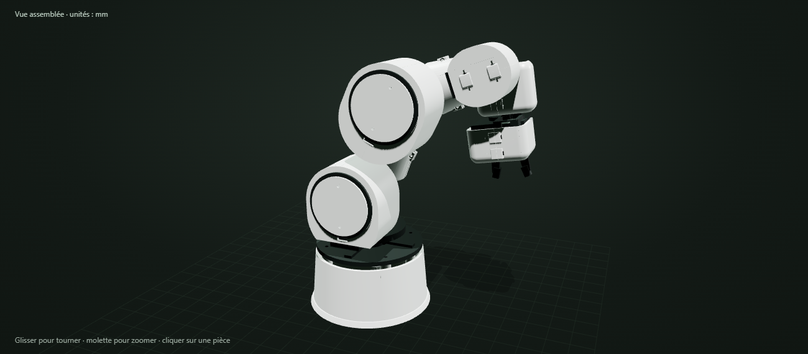

# ORBITE — Bras robot imprimé en 3D

Projet personnel réalisé en complément d’un projet universitaire pour apprendre à concevoir, fabriquer et programmer un bras robot.

L’objectif est de construire un petit bras de bureau capable de saisir et déplacer des objets légers. Il possède **cinq articulations et une pince motorisée**, soit **six servomoteurs**, avec une armature et des coques démontables imprimées en 3D.

## Matériel prévu

- **3 MG996R** : rotation de la base, épaule et coude.
- **3 MG90S** : inclinaison du poignet, rotation du poignet et pince.
- Carte compatible **Arduino Uno R3** et alimentation externe adaptée aux servos.
- Pièces en PLA imprimées sur une **Bambu Lab A1 mini**, roulements et visserie.

La programmation est prévue avec Arduino et **Flowcode**, pour travailler à partir d’organigrammes.

## État du projet

La première conception 3D **V0**, les fichiers STL et les gabarits de montage sont disponibles. L’impression, l’assemblage et la programmation restent à réaliser. Le prototype n’a pas encore été validé sur du matériel réel.

## Fichiers

- [`stl/`](stl/) : pièces de structure, coques et gabarits.
- [`sources/`](sources/) : source CAO OpenSCAD et paramètres de conception.
- [`apercu_3d.html`](apercu_3d.html) : vue 3D interactive à ouvrir dans un navigateur.
- [`LIRE_AVANT_IMPRESSION.md`](LIRE_AVANT_IMPRESSION.md) : guide d’impression et de montage envisagé.

**Première étape :** imprimer les deux gabarits du fichier [`gabarits_depart_A1_mini.3mf`](gabarits_depart_A1_mini.3mf) et vérifier l’ajustement des servos avant d’imprimer le bras complet.
